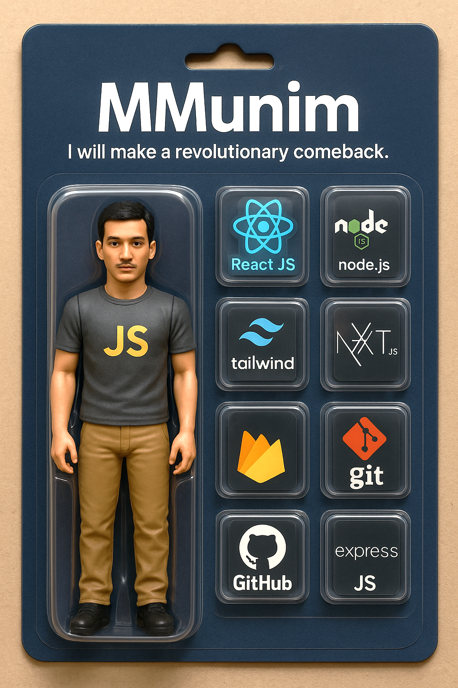

<h1 align="center">
        
    </h1>
    <!--  -->
<h3 align="center">👨‍💻 Software Developer by Choice | Turning Ideas into Modern Web Solutions 🌐 </h3>
  

  

 

➡️ Student of **CSE** 💻  
➡️ Exploring **AI Engineering**  
➡️ Interested in **Generative AI**

 

  

<!--

  

 -->
<!--  -->
  
<h3 align="center">Connect with me:</h3>
<table align="center">
<table align="center">
  <tr>
    <td align="center" width="100"></td>
    <td align="center" width="100"></td>
    <td align="center" width="100"></td>
    <td align="center" width="100"></td>
    <td align="center" width="100"></td>
    <td align="center" width="100"></td>
    <td align="center" width="100"></td>
    <td align="center" width="100"></td>
  </tr>
  <tr>
    <td align="center" width="100"></td>
    <td align="center" width="100"></td>
    <td align="center" width="100"></td>
    <td align="center" width="100"></td>
    <td align="center" width="100"></td>
    <td align="center" width="100"></td>
    <td align="center" width="100"></td>
    <td align="center" width="100"></td>
  </tr>
</table>
</table>

<!-- -->
 

<h3 align="center">Skills:</h3>

<table align="center">
  <tr>
    <td align="center" width="100"><a href="https://developer.android.com"> </a></td>
    <td align="center" width="100"><a href="https://www.arduino.cc/"> </a></td>
    <td align="center" width="100"><a href="https://git-scm.com/"> </a></td>
    <td align="center" width="100"><a href="https://www.linux.org/"> </a></td>
    <td align="center" width="100"><a href="https://www.mysql.com/"> </a></td>
    <td align="center" width="100"><a href="https://www.photoshop.com/"> </a></td>
    <td align="center" width="100"><a href="https://unity.com/"> </a></td>
    <td align="center" width="100"><a href="https://www.figma.com/"> </a></td>
  </tr>
  <tr>
    <td align="center"><a href="https://www.mongodb.com/"> </a></td>
    <td align="center"><a href="https://nextjs.org/"> </a></td>
    <td align="center"><a href="https://nodejs.org/"> </a></td>
    <td align="center"><a href="https://react.dev/"> </a></td>
    <td align="center"><a href="https://tailwindcss.com/"> </a></td>
    <td align="center"><a href="https://expressjs.com/"> </a></td>
    <td align="center"><a href="https://firebase.google.com/"> </a></td>
    <td align="center"><a href="https://code.visualstudio.com/"> </a></td>
  </tr>
  <!-- <tr>
    <td align="center"><a href="https://jwt.io/"> </a></td>
    <td align="center"><a href="https://www.typescriptlang.org/"> </a></td>
    <td align="center"><a href="https://nestjs.com/"> </a></td>
    <td align="center"><a href="https://www.postgresql.org/"> </a></td>
    <td align="center"><a href="https://orm.drizzle.team/"> </a></td>
    <td align="center"><a href="https://redis.io/"> </a></td>
    <td align="center"><a href="https://www.docker.com/"> </a></td>
    <td align="center"><a href="https://nginx.org/"> </a></td>
  </tr>
  <tr>
    <td align="center"><a href="https://aws.amazon.com/"> </a></td>
    <td align="center"><a href="https://github.com/features/actions"> </a></td>
    <td align="center"><a href="https://www.javascript.com/"> </a></td>
    <td align="center"><a href="https://www.langchain.com/"> </a></td>
    <td align="center"><a href="https://www.langchain.com/langgraph"> </a></td>
    <td align="center"><a href="https://modelcontextprotocol.io/"> </a></td>
    <td align="center"><a href="https://openai.com/"> </a></td>
    <td align="center"><a href="https://www.pinecone.io/"> </a></td>
  </tr>
  <tr>
    <td align="center"><a href="https://www.python.org/"> </a></td>
    <td align="center"><a href="https://www.w3.org/SQL/"> </a></td>
    <td align="center"><a href="https://en.wikipedia.org/wiki/Object-oriented_programming"> </a></td>
    <td align="center"><a href="https://en.wikipedia.org/wiki/Role-based_access_control"> </a></td>
    <td align="center"><a href="https://en.wikipedia.org/wiki/Software_as_a_service"> </a></td>
    <td align="center"><a href="https://en.wikipedia.org/wiki/System_design"> </a></td>
    <td align="center"><a href="https://en.wikipedia.org/wiki/Software_testing"> </a></td>
    <td align="center"><a href="https://en.wikipedia.org/wiki/Continuous_integration"> </a></td>
  </tr>
  <tr>
    <td align="center"><a href="https://en.wikipedia.org/wiki/Retrieval-augmented_generation"> </a></td>
    <td align="center"><a href="https://en.wikipedia.org/wiki/Multi-agent_system"> </a></td>
    <td align="center"><a href="https://en.wikipedia.org/wiki/Prompt_engineering"> </a></td>
    <td align="center"><a href="https://platform.openai.com/docs/guides/function-calling"> </a></td>
    <td align="center"><a href="https://en.wikipedia.org/wiki/Word_embedding"> </a></td>
    <td align="center"><a href="https://en.wikipedia.org/wiki/Artificial_intelligence_safety"> </a></td>
    <td align="center"><a href="https://en.wikipedia.org/wiki/Semantic_search"> </a></td>
    <td align="center"><a href="https://en.wikipedia.org/wiki/Artificial_intelligence_agent"> </a></td>
  </tr>
  <tr>
    <td align="center"><a href="https://en.wikipedia.org/wiki/Database_design"> </a></td>
    <td align="center"><a href="https://en.wikipedia.org/wiki/Multitenancy"> </a></td>
    <td align="center"><a href="https://en.wikipedia.org/wiki/Clean_code"> </a></td>
    <td align="center"><a href="https://en.wikipedia.org/wiki/Scalability"> </a></td>
    <td align="center"><a href="https://en.wikipedia.org/wiki/Software_architecture"> </a></td>
    <td align="center"><a href="https://en.wikipedia.org/wiki/DevOps"> </a></td>
    <td align="center"><a href="https://en.wikipedia.org/wiki/Hypertext_Transfer_Protocol"> </a></td>
    <td align="center"><a href="https://en.wikipedia.org/wiki/Virtual_private_server"> </a></td>
  </tr> -->
</table>

 

<h3 align="center">Languages:</h3>
<table align="center">
  <table align="center">
  <tr>
    <td align="center" width="100"></td>
    <td align="center" width="100"></td>
    <td align="center" width="100"></td>
    <td align="center" width="100"></td>
    <td align="center" width="100"></td>
    <td align="center" width="100"></td>
    <td align="center" width="100"></td>
    <td align="center" width="100"></td>
  </tr>
</table>
</table>
 

<!--  -->

<h3 align="center">⚡ Stats ⚡</h3>  

  
  &nbsp;
  

 

        
        &nbsp;
        <!--  -->

  

<!-- 
 
  -->

<!--  -->

 

<h3 align="center">📊 Competitive Programming Stats:</h3>  

 

 

<!--  -->
<h3 align="center">▶️ Youtube Channel</h3>

 

<!--   -->

<h4 align="center">All rights reserved by MMunim © 2025 | Follow me on [GitHub](https://github.com/mmunim90)</h4>

<!--  -->
